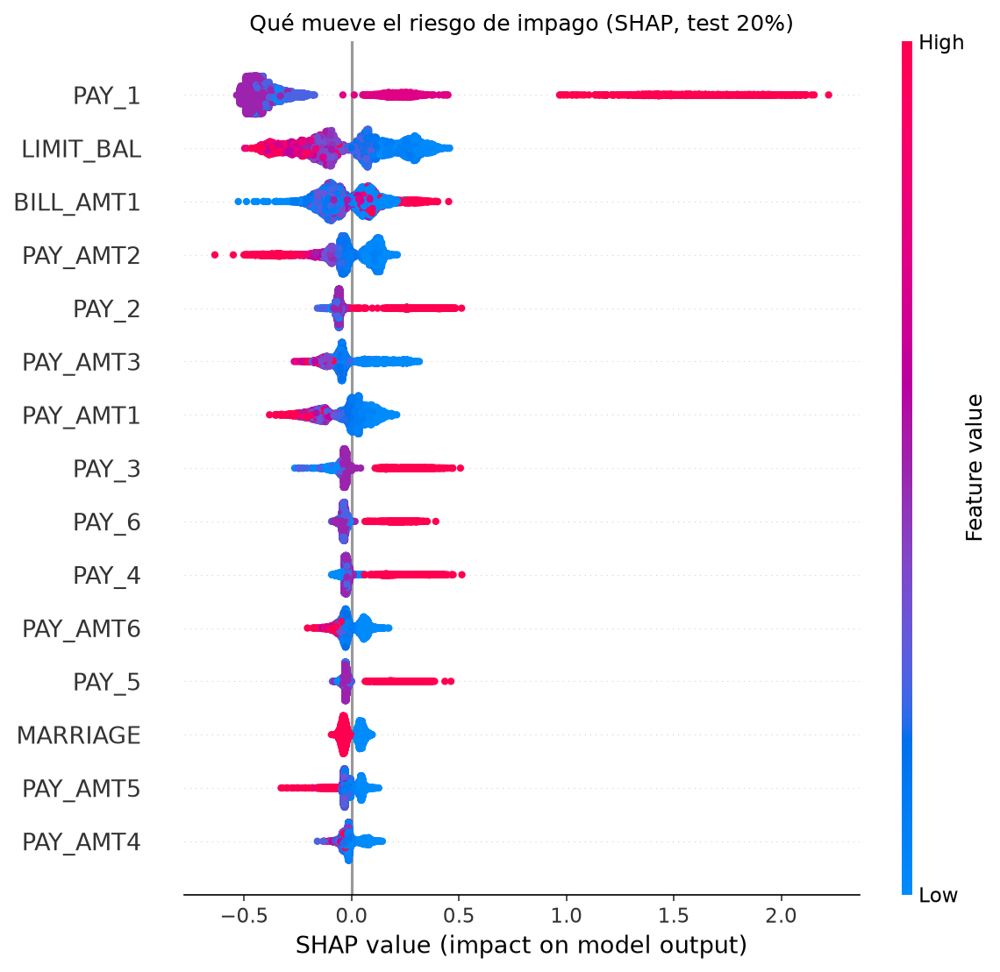

# 🏦 Credit Risk Lab

Laboratorio de **scoring de riesgo crediticio** de principio a fin: desde los datos crudos
hasta un modelo explicable servido por API — el problema central de la banca, resuelto
con las prácticas que exige el sector (explicabilidad, trazabilidad, despliegue).

## ¿Por qué este proyecto?

El scoring de crédito es el caso de uso de ML más regulado y maduro de la industria
financiera. Un modelo que predice bien no basta: la normativa (EBA, AI Act) exige poder
**explicar cada decisión**. Este proyecto ataca exactamente eso:

- **Modelo**: predicción de impago (probabilidad de default) con Gradient Boosting.
- **Explicabilidad**: SHAP values globales (qué mueve el riesgo en la cartera) y locales
  (por qué se deniega *esta* solicitud), traducidos a *reason codes*.
- **Producción**: API de scoring con FastAPI + Docker, con el patrón de un servicio real.

## Datos

| Fase | Dataset | Tamaño |
|------|---------|--------|
| Actual | [UCI — Default of Credit Card Clients](https://archive.ics.uci.edu/dataset/350/default+of+credit+card+clients) (Taiwán, 2005) | 30.000 clientes, 23 variables |
| Próxima | [Home Credit Default Risk](https://www.kaggle.com/competitions/home-credit-default-risk) (Kaggle) | 307.000 préstamos, multi-tabla |

Los datos **no se versionan**: `python src/download_data.py` los descarga y deja en `data/raw/`.

## Estructura

```
credit-risk-lab/
├── src/
│   ├── download_data.py    # Descarga y validación del dataset
│   ├── prepare.py          # Limpieza y features → data/processed/
│   └── train.py            # Entrenamiento + métricas + SHAP
├── notebooks/              # EDA y análisis
├── app/                    # API FastAPI de scoring (+ tests/ y Dockerfile)
├── models/                 # Artefactos entrenados (xgb.json, medians.json)
├── reports/figures/        # Gráficas generadas
└── data/                   # raw/ y processed/ (gitignored)
```

## Uso

```bash
pip install -r requirements.txt
python src/download_data.py
python src/prepare.py
python src/train.py
python src/explain.py
```

## Resultados (test 20%)

| Modelo | ROC AUC | PR AUC | KS | Brier |
|--------|---------|--------|-----|-------|
| Regresión logística | 0.708 | 0.494 | 0.364 | 0.147 |
| **XGBoost** | **0.780** | **0.561** | **0.429** | **0.135** |

KS > 0.4 : discriminación de nivel "scorecard fuerte" según el estándar del sector.

## Explicabilidad



Cada denegación se traduce a **reason codes** deterministas (plantillas sobre SHAP values,
reproducibles ante un regulador — por eso no se generan con un LLM):

```json
{
  "p_default": 0.87,
  "reason_codes": [
    "Estado de pago del último mes: 2 mes(es) de retraso",
    "Estado de pago hace 2 meses: 2 mes(es) de retraso",
    "Importe facturado el último mes con patrón de uso atípico"
  ]
}
```

**Fairness**: los atributos protegidos o sensibles (`SEX`, `AGE`, `MARRIAGE`, `EDUCATION`)
nunca aparecen como motivo de denegación. La dirección de cada razón ("elevado", "reducido")
se calcula contra la mediana de la cartera, no se asume.

## API de scoring

```bash
uvicorn app.main:app          # docs interactivas en http://localhost:8000/docs
pytest tests/ -v              # smoke tests (incluye el contrato de fairness)
```

```bash
curl -X POST http://localhost:8000/score -H "Content-Type: application/json" -d '{
  "LIMIT_BAL": 20000, "SEX": 2, "EDUCATION": 2, "MARRIAGE": 1, "AGE": 35,
  "PAY_1": 3, "PAY_2": 2, "PAY_3": 2, "PAY_4": 2, "PAY_5": 2, "PAY_6": 2,
  "BILL_AMT1": 20000, "BILL_AMT2": 18000, "BILL_AMT3": 15000,
  "BILL_AMT4": 12000, "BILL_AMT5": 10000, "BILL_AMT6": 8000,
  "PAY_AMT1": 0, "PAY_AMT2": 0, "PAY_AMT3": 0,
  "PAY_AMT4": 0, "PAY_AMT5": 0, "PAY_AMT6": 0
}'
# → {"p_default": 0.79, "risk_band": "alto", "reason_codes": [...]}
```

Con Docker:

```bash
docker build -t credit-risk-api .
docker run -p 8000:8000 credit-risk-api
```

## Roadmap

- [x] Fase 1 — Datos + EDA + baseline XGBoost con métricas honestas (AUC, KS, calibración)
- [x] Fase 2 — SHAP: explicabilidad global y local, reason codes deterministas
- [x] Fase 3 — API de scoring (FastAPI + Docker) con endpoint `/score` explicado y testeado
- [ ] Fase 4 — Variante Deep Learning tabular (PyTorch) y comparativa rigurosa
- [ ] Fase 5 — Upgrade a Home Credit (multi-tabla, feature engineering serio)
- [ ] Demo Streamlit + artículo en [el blog](https://www.jonnathanospina.com/pages/blog.html)

---

**Jonnathan Ospina** — [jonnathanospina.com](https://www.jonnathanospina.com) · [LinkedIn](https://www.linkedin.com/in/jonnathanospinam)
